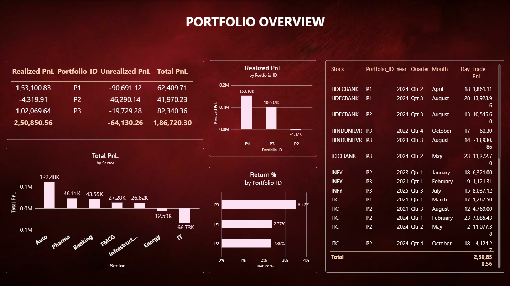
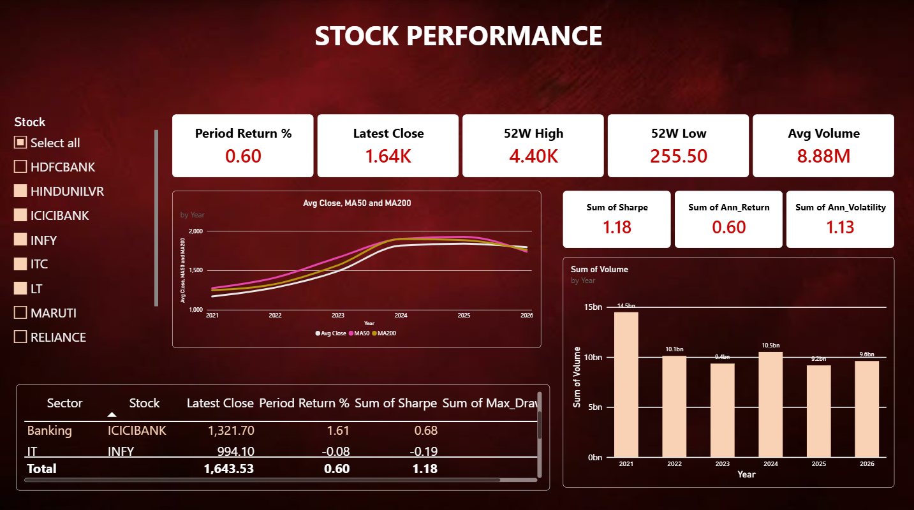
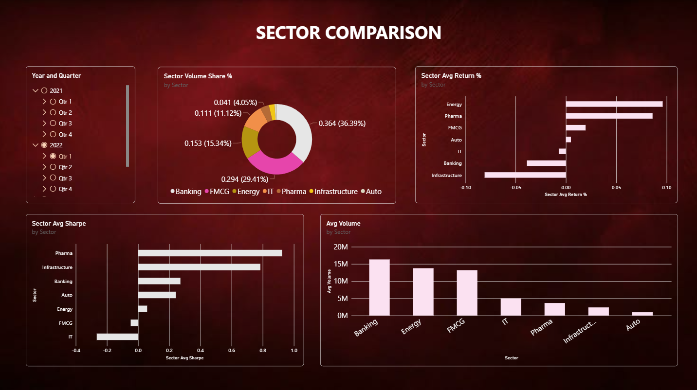
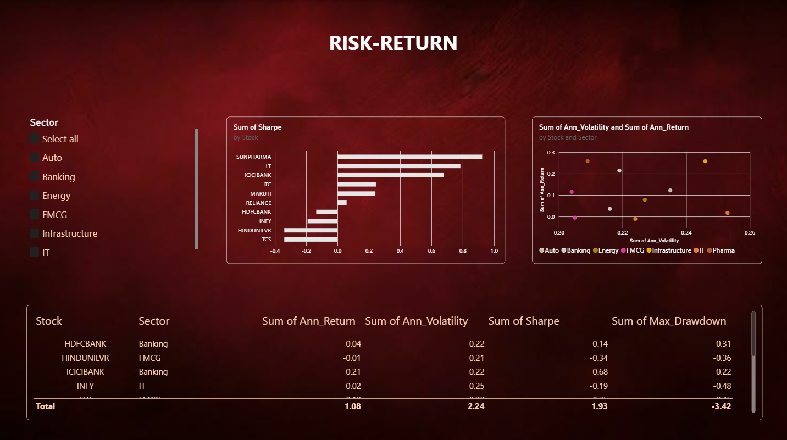
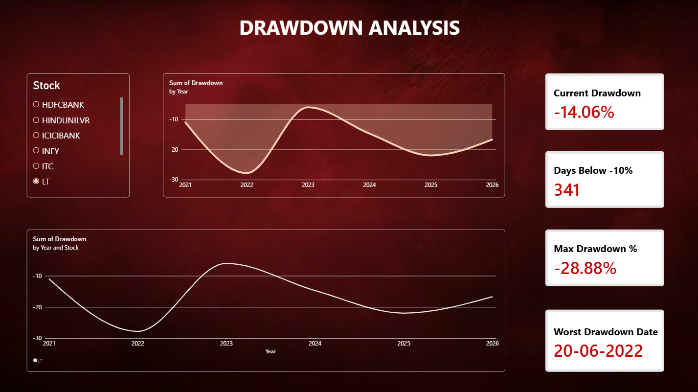
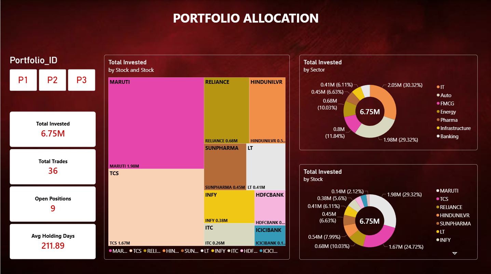

# Stock Market & Portfolio Performance Analytics

End-to-end analytics project on 10 NSE stocks (2021-2026) and 3 sample portfolios, built with **Python, SQL (SQLite) and Power BI**.

## Tools
- **Python** (pandas, numpy, yfinance): returns, volatility, Sharpe ratio, max drawdown, correlation
- **SQL** (SQLite): daily/monthly returns, best/worst stocks, sector performance, volume analysis, portfolio P&L, holding-period returns
- **Power BI**: 6-page interactive dashboard

## Project Structure
```
data/       prices.csv, transactions.csv, risk_return.csv, daily_returns.csv, drawdown_long.csv
python/     1_build_data.py, 2_analysis.py
sql/        queries.sql, portfolio.db
powerbi/    portfolio_dashboard.pbix, screenshots/
```

## Data
- **prices.csv**: Date, Stock, Open, High, Low, Close, Volume, Sector (source: Yahoo Finance, adjusted prices)
- **transactions.csv**: Portfolio_ID, Stock, Buy_Date, Sell_Date, Quantity, Buy_Price, Sell_Price (sample trades built from real closing prices; blank sell fields = open positions)

## Key Results
| Portfolio | Realized P&L | Unrealized P&L | Total P&L |
|---|---|---|---|
| P1 | Rs 1,53,101 | Rs -90,691 | Rs 62,410 |
| P2 | Rs -4,320 | Rs 46,290 | Rs 41,970 |
| P3 | Rs 1,02,070 | Rs -19,729 | Rs 82,340 |
| **Total** | **Rs 2,50,851** | **Rs -64,130** | **Rs 1,86,720** |

Realized P&L was cross-checked: Python and SQL results match exactly.

Assumptions: risk-free rate 6.5%, 252 trading days, unrealized P&L valued at the latest available close.

## Dashboard Preview

### Portfolio Overview


### Stock Performance


### Sector Comparison


### Risk-Return


### Drawdown Analysis


### Portfolio Allocation


## How to Run
```
pip install yfinance pandas numpy
python python/1_build_data.py
python python/2_analysis.py
```
Open `sql/portfolio.db` in DB Browser for SQLite, and `powerbi/portfolio_dashboard.pbix` in Power BI Desktop.